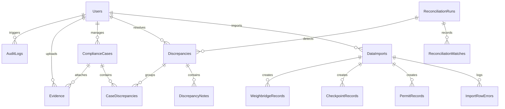

# MineShield Architecture Specification

## 1. System Overview & Topology

MineShield is architected as an automated regulatory intelligence and reconciliation platform designed to audit mineral transport logistics across disparate data providers.

The platform processes three high-volume, independently generated operational data streams:
1. **Permit Issuer System**: Government mining concessions granting mineral transport rights with designated tonnage, allowable transit window, vehicle assignments, and route definitions.
2. **Transit Surveillance Infrastructure**: Automated RFID gate readers and Automatic Number Plate Recognition (ANPR) cameras stationed at key transit checkpoints and toll gantries.
3. **Certified Weighbridge Terminals**: Industrial gross and tare measurement systems recording physical mineral shipments before transport onto public highways.

```
+-----------------------------------------------------------------------------------+
|                                PRESENTATION TIER                                  |
|  React 19 SPA (Vite) | CSS Grid / Flexbox | Responsive Layout | Modular UI Views  |
+-----------------------------------------+-----------------------------------------+
                                          | JSON over HTTPS
                                          v
+-----------------------------------------------------------------------------------+
|                                APPLICATION TIER                                   |
|  Node.js / Express REST API Engine                                                |
|                                                                                   |
|  +--------------------+  +--------------------+  +--------------------+           |
|  | Ingestion Engine   |  | Reconciler Engine  |  | Security & Auth    |           |
|  | - CSV Parsing      |  | - 8 Rule Pipelines |  | - JWT & Passwords  |           |
|  | - Vehicle Normal.  |  | - Tolerance Math   |  | - Server RBAC      |           |
|  | - Row Diagnostics  |  | - Auto-Resolution  |  | - Rate Limiting    |           |
|  +--------------------+  +--------------------+  +--------------------+           |
|  +--------------------+  +--------------------+  +--------------------+           |
|  | Case Management    |  | Evidence Vault     |  | Audit Log Stream   |           |
|  | - State Machine    |  | - Magic Bytes      |  | - Immutable Events |           |
|  | - Discrepancy Map  |  | - SHA-256 Hashing  |  | - Append-Only DB   |           |
|  +--------------------+  +--------------------+  +--------------------+           |
+------------------------------------+----+-----------------------------------------+
                                     |    |
           +-------------------------+    +-------------------------+
           v                                                        v
+--------------------------------------+  +-----------------------------------------+
|            PERSISTENCE TIER          |  |               STORAGE TIER              |
|  Database Abstraction (`db/index.js`)|  |  Storage Abstraction (`storageService`) |
|  - SQLite3 (Local ACID Demonstrator) |  |  - Local File System (`uploads/`)       |
|  - Azure SQL Database (T-SQL Cloud)  |  |  - Azure Blob Storage (Enterprise Cloud)|
+--------------------------------------+  +-----------------------------------------+
```

---

## 2. Relational Database Architecture (3NF Schema)

MineShield enforces rigorous Third Normal Form (3NF) relational constraints across 15 structured tables, guaranteeing ACID transaction semantics and referential integrity.

### Schema Entity Relationship Summary



### Table Definitions & Specifications

1. **`Users`**: Stores system users, encrypted bcrypt credentials, full names, official emails, and assigned roles (`Administrator`, `ComplianceReviewer`, `ReadOnlyAuditor`).
2. **`Settings`**: System-wide configurable runtime parameters (e.g., `quantity_tolerance_pct`, `reconciliation_time_window_hours`).
3. **`DataImports`**: Ingestion batches recording source type, original filename, calculated SHA-256 file hash, total rows, valid rows, error rows, and upload timestamp.
4. **`ImportRowErrors`**: Granular row-level diagnostic logs tracking file row numbers, error categories, raw input fragments, and human-readable rejection reasons.
5. **`PermitRecords`**: Authorized mineral transport permits with normalized vehicle registrations, authorized mineral tonnage, leaseholders, origins, destinations, and validity periods.
6. **`CheckpointRecords`**: Physical checkpoint and ANPR passage records capturing checkpoint IDs, RFID tags, normalized vehicle numbers, speed, lane, and transit timestamps.
7. **`WeighbridgeRecords`**: Certified scale measurements capturing weighbridge IDs, ticket numbers, vehicle numbers, gross weight, tare weight, net weight, and weighment timestamps.
8. **`ReconciliationRuns`**: Execution audit header recording reconciliation batch timestamp, triggered user, parameters used, total evaluated records, matched count, and discrepancies flagged.
9. **`ReconciliationMatches`**: Composite join records linking a `permit_id`, `checkpoint_id`, and `weighbridge_id` with match confidence scores and computed quantity differences.
10. **`Discrepancies`**: Flagged anomalies recording rule types, severity levels (`CRITICAL`, `MAJOR`, `MODERATE`, `MINOR`), status (`OPEN`, `UNDER_REVIEW`, `RESOLVED`, `DISMISSED`), explanation, and linked source record foreign keys.
11. **`DiscrepancyNotes`**: Append-only investigation notes, reviewer comments, and audit justifications for discrepancy status transitions.
12. **`ComplianceCases`**: Formal regulatory enforcement cases grouping multiple related discrepancies under an assigned compliance officer, tracking formal case status (`OPEN`, `INVESTIGATING`, `ACTION_REQUIRED`, `RESOLVED`, `CLOSED`).
13. **`CaseDiscrepancies`**: Many-to-many junction table mapping individual discrepancies to active compliance cases.
14. **`Evidence`**: Vault files attached to cases, recording original filename, system storage key, MIME type, file size, SHA-256 content fingerprint, and upload user.
15. **`AuditLogs`**: High-fidelity, append-only security log recording timestamp, user ID, client IP address, action classification, entity type, entity ID, and structured JSON context payload.

---

## 3. Ingestion & Normalization Pipeline

The ingestion service (`services/importService.js`) processes heterogeneous CSV files using a fault-tolerant streaming architecture:

1. **Content Hashing & Deduplication**:
   - Computes full file SHA-256 before disk persistence.
   - Rejects identical file uploads immediately with HTTP 409 Conflict to prevent accidental duplicate processing.
2. **Schema & Header Discovery**:
   - Dynamically inspects column headers against expected aliases (e.g., matching `Vehicle_Number`, `vehicle_reg`, `Truck_No` to the normalized field `vehicle_no`).
3. **Identifier Normalization**:
   - Sanitizes vehicle registration strings through `normalizeVehicleNo()`: strips spaces, dashes, dots, and underscores, converting to canonical uppercase format (e.g., `"KA-04-E-1234"` $\rightarrow$ `"KA04E1234"`).
4. **Row-Level Validation**:
   - Evaluates mandatory fields, numeric positive boundaries, date parsing validity, and format integrity.
   - Invalid rows are cataloged in `ImportRowErrors` with precise 1-based row indices and descriptive error messages; valid rows proceed into relational staging.
5. **Atomic Commit**:
   - Ingestion executes within an atomic database transaction. If system failure occurs mid-import, the entire batch rolls back cleanly without leaving orphaned records.

---

## 4. Multi-Source Reconciliation Engine

The reconciliation engine (`services/reconciliationEngine.js`) enforces deterministic matching across disparate data feeds:

- **Source Availability Safeguard**: The engine determines which sources have active imports. It never flags `MISSING_CHECKPOINT` or `MISSING_WEIGHBRIDGE` if checkpoints or weighbridges have not yet been imported into the system.
- **Normalized Join Pipeline**: Permits, checkpoints, and weighbridge logs are linked by composite keys: normalized vehicle registration and overlapping transit timestamps.
- **Idempotence & State Preservation**:
  - Re-running reconciliation does not spawn duplicate active discrepancies. Existing un-resolved discrepancies maintain their lifecycle status and assigned investigation notes.
- **Changed-Data Auto-Resolution**:
  - If a late-arriving weighbridge or checkpoint import satisfies an earlier missing-record flag, subsequent reconciliation automatically marks the previous discrepancy as `RESOLVED` with an explanatory system resolution note.

---

## 5. Storage & Cloud Abstraction Layer

MineShield implements clean provider abstractions to support both zero-dependency local development and enterprise cloud production deployments:

### Database Provider Abstraction (`db/index.js`)
- **Local Provider (`sqlite3`)**: Runs on SQLite3 with WAL mode and foreign key enforcement enabled. Provides instant, dependency-free development and local viva demonstration.
- **Cloud Provider (`mssql` / `db/azureSqlProvider.js`)**: Connects to Azure SQL Database using enterprise T-SQL pooling. All SQL operations adhere to standard relational syntax supported by both engines.
- **Production Fail-Fast**: If `DATABASE_PROVIDER=azuresql` is specified but server credentials or networking fails, the backend immediately exits with a descriptive error rather than silently degrading to local storage.

### Storage Provider Abstraction (`services/storageService.js`)
- **Local Storage Provider**: Saves files to `./uploads/` with UUID-based collision-resistant filenames while tracking original filenames in the database.
- **Azure Blob Storage Provider**: Streams files to Azure Blob Storage containers using `@azure/storage-blob`.
- **Fail-Fast Validation**: Unconfigured Azure storage triggers explicit diagnostic errors in production mode.

---

## 6. Security Model & Defense-in-Depth

MineShield embeds comprehensive application-level security controls across all layers:

1. **Server-Side Role-Based Access Control (RBAC)**:
   - Client-side UI visibility is treated strictly as an ergonomic convenience. Every API route verifies caller identity and role via JWT middleware (`middleware/auth.js`).
   - `ReadOnlyAuditor` users are strictly barred from mutation routes (POST, PUT, DELETE) with HTTP 403 Forbidden.
2. **Brute-Force & Abuse Rate Limiting**:
   - In-memory sliding window rate limiter (`middleware/rateLimiter.js`) restricts authentication attempts to 10 consecutive failures per IP before enforcing HTTP 429 Too Many Requests.
3. **Evidence Tamper Verification & Magic-Byte Validation**:
   - Uploaded evidence is validated against magic-byte signatures (`utils/fileValidation.js`) to reject spoofed file extensions (e.g., renaming an `.exe` to `.pdf`).
   - Evidence files have their SHA-256 hashes verified on-disk during audit inspections to detect tampering.
4. **Spreadsheet Formula Injection (CSV Injection) Neutralization**:
   - All dynamic exports sanitize formula trigger characters (`=`, `+`, `-`, `@`, `\t`, `\r`) in `utils/csvSanitizer.js` by prefixing a single apostrophe (`'`) and adhering to RFC-4180 quotation rules.
5. **Immutable Audit Logging**:
   - All state modifications (logins, imports, reconciliation runs, case updates, evidence uploads) stream to `AuditLogs`. No update or delete endpoints are exposed on the audit log resource.
